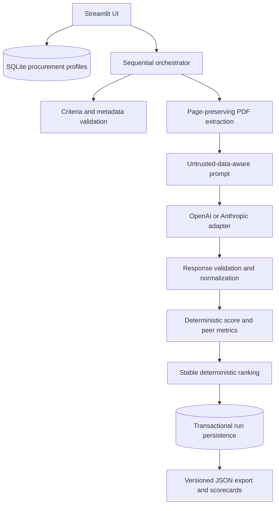

# Procura AI — Agentic RFP Evaluation

A Streamlit application for evaluating supplier proposals against configurable procurement requirements. Python validates the rubric, extracts PDF text, normalizes model responses, computes weighted scores and peer benchmarks, ranks suppliers, and stores each run in SQLite. An LLM assesses only the evidence in one proposal at a time; it does not calculate rankings.

The six PDFs in [`synthetic_rfps/`](./synthetic_rfps) are fictional educational samples for the same procurement scenario. They are not real supplier endorsements or confidential data.

## Requirements and installation

- Python 3.11 or newer (tested target: Python 3.11+).
- A user-supplied OpenAI or Anthropic API key for live evaluations. The UI launches without a key.

### Windows PowerShell

```powershell
py -3.11 -m venv .venv
.\.venv\Scripts\Activate.ps1
python -m pip install -r requirements.txt
python -m streamlit run app.py
```

### macOS / Linux

```bash
python3.11 -m venv .venv
source .venv/bin/activate
python -m pip install -r requirements.txt
python -m streamlit run app.py
```

The app initializes `data/procura_ai.sqlite3` and seeds the sample profile on first launch. To reset local data, stop the app and remove that specific SQLite file; the next launch recreates it. The seed rubric is stored as data in `database.py`, not embedded in scoring logic.

## Using the application

1. In **Procurement setup**, edit a procurement profile's title, category, scope, criteria, guidance, weights, maximum scores, and active flags. Active weights must total 100%. You can create additional profiles using a copy of the current rubric, then edit that profile independently.
2. In the sidebar's **Provider setup**, choose OpenAI or Anthropic, enter a supported model name, and enter your API key in the password field. Use **Test connection** to explicitly test it. The application does not call a provider until you test or start an evaluation. **Clear key** removes the session-state entry. The key is not stored in source code, SQLite, files, exports, or application error messages. This does not guarantee immediate erasure from every process-memory location.
3. Upload one or more PDFs, assign a unique supplier name, ISO submission date, and historical experience rating from 0 to 5.
4. Choose **Evaluate suppliers**. Proposals are processed sequentially. A partial run ranks only successfully normalized evaluations; failed suppliers are listed in run warnings and are never given fabricated scores.
5. View results, detailed scorecards, evidence, and validation warnings immediately below the evaluation controls. Use **Leaderboard & export** to reopen a saved run and download its complete JSON.

Use the six PDFs in `synthetic_rfps/` for a sample batch. A representative versioned JSON export is available at [`examples/sample_export.json`](./examples/sample_export.json).

## Architecture



Modules are organized under `services/` for extraction, prompting, validation, scoring, ranking, orchestration, and export. `providers/` contains the official-SDK adapters; `database.py` owns SQLite schema and persistence. Runs retain separate prompt and response-schema versions; schema initialization upgrades an older local database by adding the schema-version column.

## Scoring and normalization

For criterion *i*, with score `s_i`, configured maximum `m_i`, and weight `w_i` expressed as percentage points:

```text
absolute_score = sum((s_i / m_i) * w_i)
benchmark_i = max(s_i among successfully evaluated suppliers)
gap_i = s_i - benchmark_i
relative_i = (s_i / benchmark_i) * 100, if benchmark_i > 0
relative_i = 100 for all suppliers, if benchmark_i == 0
PPI = sum(relative_i * w_i) / sum(w_i)
```

The zero-benchmark rule is neutral: every eligible supplier has the same zero score for that criterion, so none gains a relative advantage. PPI uses the brief's peer-relative formula, not normalized absolute score.

Ranking is performed only after scoring: higher PPI, earlier ISO `YYYY-MM-DD` submission date, higher historical experience rating, then supplier name ascending using case-insensitive comparison and the original name as final fallback. Experience ratings use a 0–5 scale. Ranks are sequential positions after sorting.

Missing criteria normalize to 0 with status `normalized_missing`; malformed scores normalize to 0 with `normalized_invalid`; out-of-range numeric scores are clipped and marked `normalized_clipped`; duplicate criterion IDs normalize that criterion to 0 with `normalized_duplicate`; unknown IDs are ignored with warnings. Provider-supplied maximum scores are ignored in favor of configured values. A valid score of 0 retains `valid` status. Each batch snapshots its active criteria. Only successful normalized suppliers take part in peer metrics and ranking.

PDF text is extracted page-by-page. Empty/image-only PDFs are rejected with an OCR-required message. Files are limited to 20 MB and extracted text to 250,000 characters. OCR, file malware scanning, and provider-side retention controls are outside this prototype.

## Tests

```powershell
python -m pytest -q
```

Tests use local PDF fixtures and mocked providers; they do not need API credentials or incur provider charges. The suite covers rubric validation, PDF handling, normalization, deterministic formulas and tie-breaks, SQLite transactions, export secret checks, and successful/partial/failed orchestration.

## Security and privacy

- API keys are entered at runtime and held in Streamlit session state for provider calls. They are not persisted or included in prompts, run records, exports, or application-generated error messages.
- Proposals are untrusted content and explicitly delimited in prompts. Prompt-injection defenses are not a guarantee against model failures. Review evidence and scores before relying on them.
- SQLite stores procurement data and run results locally without encryption. Protect the host and database file accordingly; `.gitignore` excludes local SQLite files.
- The app sends proposal text and prompts to the selected third-party model provider. Do not upload sensitive data unless authorized under your organization's policies and provider terms.
- Model outputs can be inaccurate. Evidence excerpts and page numbers are model-generated and should be checked against the original PDF. The application rejects page numbers beyond the PDF and checks evidence against extracted text while tolerating Unicode, punctuation, and line-break formatting differences. Evidence that still does not match is flagged for review.
- No live provider evaluation or deployment has been preconfigured.

## Streamlit Community Cloud

1. Push the project to a private or public GitHub repository according to your data and code policies.
2. Create a Community Cloud app pointing to `app.py`; include `requirements.txt` at repository root.
3. Deploy and wait for dependency installation. No API key needs to be configured as a deployment secret because users enter their own key in the runtime UI.
4. Users must supply their own provider credentials. Treat the runtime filesystem and SQLite persistence as deployment-specific; do not assume durable database storage or session-key erasure guarantees in hosted environments.

Community Cloud deployments should be limited to data appropriate for the selected hosting and model-provider terms.
